# steady-finch in the SIG Predictions Cup

By [Cullen Campana](https://www.linkedin.com/in/cullen-campana-18b282270/)

<picture>
  <source media="(prefers-color-scheme: dark)" srcset="figures/equity-dark.png">
  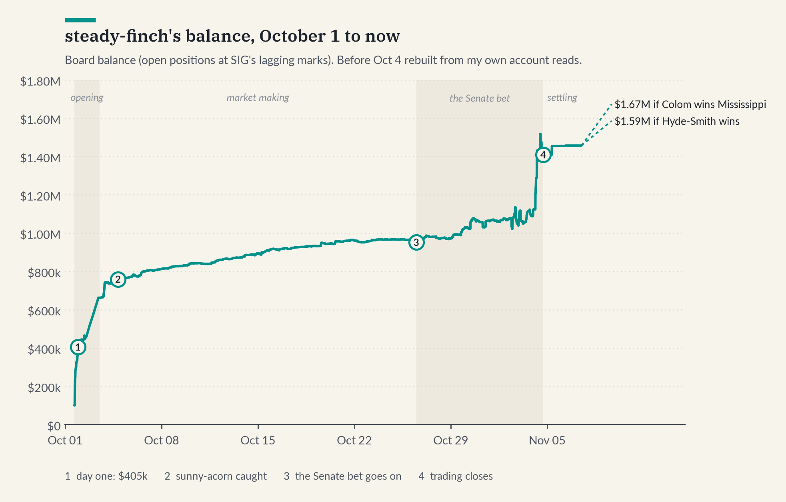
</picture>

I (steady-finch-4087) took part in SIG's (Susquehanna's) prediction market on the 2026 midterm elections, and it was a blast. SIG gave everyone who signed up $100,000 of play money and contracts on the outcomes of all the US midterm races for the Senate, House, governors and chamber control, 237 contracts in all. Rankings were purely based on final balance after everything settled, with $30k for first, $5k for second and $2.5k for third. About 1,970 people took part.

I was inspired to write up my side by Teun's (nimble-beacon) write-up [here](https://github.com/IHateVolatility/SIG-Prediction-Cup). Just like him, I was an avid user of Claude Code to accelerate the development, research and iteration of ideas in the competition.

## The plan

My plan going in was to do some sort of latency arbitrage. I had some experience running latency arbitrage strategies on betting markets before, and I know they can be quite lucrative. I spent about a week before the competition developing a latency arbitrage system with data ingestion from Polymarket and Kalshi, and even built my own election model fitted on historical election data and polls (this was very useful later). I set up a server in AWS us-west-1, next to SIG's servers in San Francisco, which cut a request from 269 ms to 109 ms. I minted 16 API keys, because at the time the API limits were per key, so I planned on using a key pool to send thousands of requests per minute.

On the day the competition started, about 5 hours before the open, SIG made the limits per account and dropped them to 30 writes (and 100 reads) per minute. So I went from 1,600 writes per minute to 30, effectively killing any sort of HFT latency arbitrage. I started the competition with no working system, but with a good base of code and an election model to build on.

## Opening day

I logged in about 10 minutes after the start of the competition just to see what was going on, and watching it I noticed some very odd orders happening. Markets that Kalshi valued at 99c, or near certain, were being sold in massive orders for 1c, because there was almost no one on the book. When I placed one and got filled I was really surprised, so I quickly started placing huge orders by hand on a bunch of the highest-action markets, around 2c, to undercut anyone else.

I blame the confusing UI for this. I think a lot of people logged in and wanted to place orders but found it confusing at first. If you pressed the button to fill out a sell order, it would automatically fill in the maximum number of shares your entire account value could cover, not just the shares you actually held, and I think this got a lot of people. So there was an influx of bad orders, and a select few made hundreds of thousands on this first day. I quickly had Claude set up a script to quote 2-5c buys and 95-98c sells on all markets.

My first fill came at 16:30 UTC. The biggest early one was on "Republicans win the Rhode Island Senate", a race Kalshi had near zero. Between 16:36 and 16:47 someone bought about 213,000 shares from me at 95 to 99c, and that night I bought most of them back at 7c, for about $205k of profit on that one market. The script was running by about 18:00. The account went from $100k to $289k by 18:28 UTC and to $405k by 22:15.

In the first 2 days using this I made about $415k: by the evening of October 2 the account was at $515k, 8th of 839 accounts. By the end of October 3 it was at $743k. Looking back, the fills from those first three days are worth about $658k at settlement, over 40% of everything I made.

<picture>
  <source media="(prefers-color-scheme: dark)" srcset="figures/daily-dark.png">
  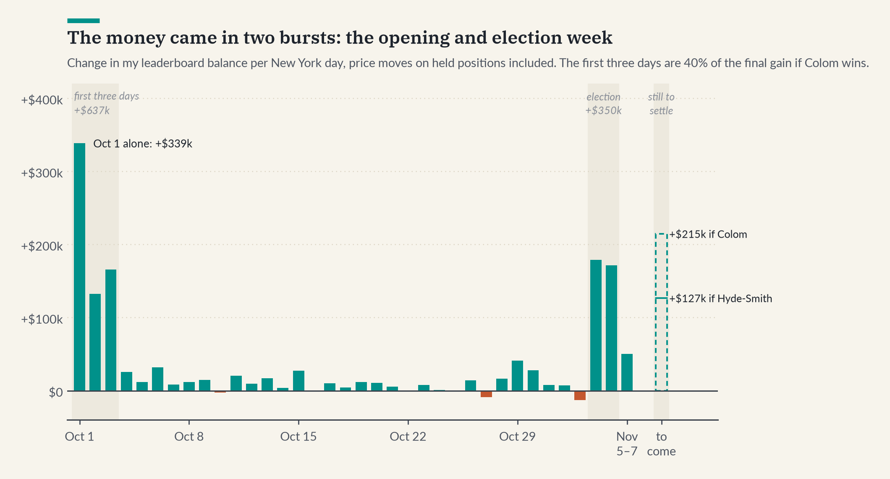
</picture>

## Replays

As people got used to the system and UI, the markets started to get more competitive and there was more quoting near the fair price. There were, however, still huge sweeps (single big orders) that would eat 10-20c deep into books, and these were the main moneymaker I found. I threw together an MM (market making) script that kept buy and sell orders on the book for others to trade against, quoting wide around the SIG mid and undercutting other large orders. Some markets were very mispriced on SIG, but from the replays and the analysis I did on how the markets converged, I found SIG prices moved toward Kalshi's fair value extremely slowly. A 4c gap only closed about 15% in a day, and on near-certain races it didn't close at all. So buying mispriced markets and holding them was marginal gains. It paid more to play into the delusions of the market and quote around a poorly priced market to capture the spread, with a bias against accidentally opening large positions against the Kalshi and Polymarket prices.

I did some quick math on this early on. Buying a near-certain market at 20% guaranteed value works out to about 0.6% a day until settlement, and over the first days of market making my balance had been growing about 2% a day. It was clear that using all my capital to market make was the optimal path for now, so I kept my cash fluid and let the flow come to me at a favorable price. It slowed down later, to about 1% a day from October 9 to 24, but that was still nearly twice what holding would have paid.

I was also biased against getting stuck in near-certain markets. I found some interesting dynamics there: one person buying $100k worth of 10c contracts forced market makers to buy a collective $900k of contracts as the other side. This led to some strange effects, where an aggressive buy could actually collapse the price as makers got stuck in large positions they wanted to close. I decided to stay away from this because it was quite unpredictable.

Over the next few days I developed a book replay tool to replay orders on prospective quoting rules, allowing me to fine-tune my market making scripts for maximum realized P/L.

Here are the same four days (October 5-9) replayed under different rules. The plain ladder would have made about twice what my live rules did, and each "safety" filter I added on top of it cost money.

<picture>
  <source media="(prefers-color-scheme: dark)" srcset="figures/replays-dark.png">
  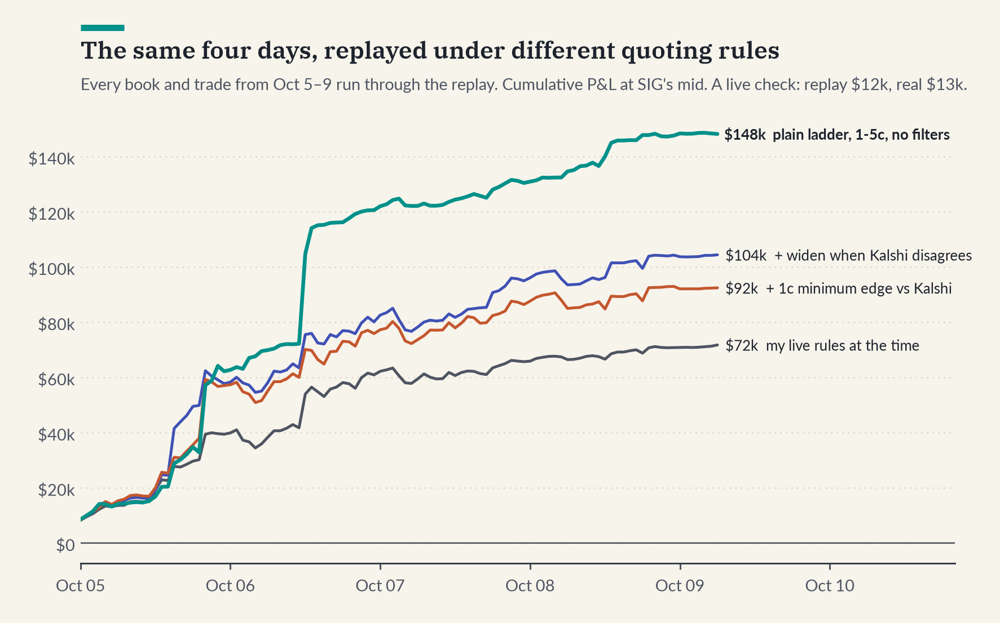
</picture>

What I learned from it:
- Tight quoting in quiet hours made nothing. Everything I tried came out between −$360 and +$100 an hour.
- The money was in the sweeps. The first weekend had 229 sweeps that paid $2.45M to resting orders, and I had almost nothing 7.5 to 12.5c out, where other people made about $437k.
- My safety filters were costing me. Widening my quotes when Kalshi disagreed and a minimum-edge rule cost over $40k in the replay, so I dropped them.
- Fancier market making did worse than simple rules. An Avellaneda-Stoikov style quoter that skewed its prices by inventory lost between $126 and $2,500 an hour in the quiet hours. I also trained an adaptive quoter that picked the price and size for every market each cycle from learned fill and value models. In the same two test windows, it made $40-69k and $32-51k, against $98k and $55k for the plain ladder of fixed sizes I ended up with (below). Its models were too optimistic about where it would get filled, and it cancelled and re-placed orders twice as often as the ladder, so most of its orders never sat long enough in the queue to get hit. Orders that sat still and waited for the sweeps beat it.

The ladder I ended up with was 2k, 5k, 30k, 90k and 50k shares at 1 to 5 cents. It beat the live loop in two separate test windows, by $37.6k and $19.5k, so I switched to it. This changed slightly a few more times over the next week and a half.

## The dashboard

The tool I used the most, day to day, was a dashboard Claude built for me. It reloaded every 15 seconds from my own recordings of the market and showed how much resting orders were taking from takers over the last 15 minutes, hour and six hours, the top of the leaderboard and how their P/L was moving, the markets seeing the most action, every big order as it happened, and my own fills. When a big sweep came through I would see it within seconds, and I could jump in by hand, either buying back what had just been dumped or putting a big order where the next sweep was likely to land. I mostly watched my account balance, the makers' take per bucket and the recent large orders pane. I checked it regularly every day of the competition, and would often come across big bursts of orders and get in the middle of them by hand.

Here is what it looked like at the close on November 4. In the last six hours, resting orders took $552k from 3,767 taker orders, and I took $30k of it, almost all in the last hour, when sweeps hit my 10c bids on ME-02 and Rhode Island.

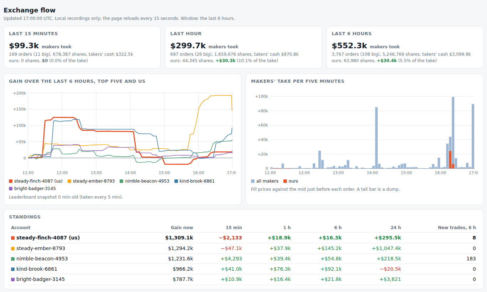

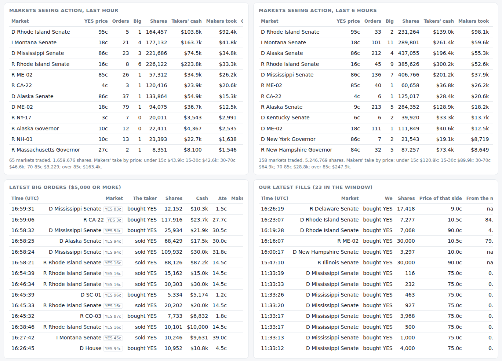

## sunny-acorn

On October 4 the leader was sunny-acorn-8216 at $877k, but something about their trading looked wrong. They had gone completely quiet: their trade count hadn't moved in about two days. Then on the evening of October 4, market activity and their trade volume suddenly exploded. It looked very off, so I investigated. Over about a two-hour period a very blatant pattern emerged: sunny-acorn was filling orders of exactly 15,000 shares by the hundreds, placing their own orders seconds before the takers would come in and making approximately $75 on every round trip. Overall market volume over this period was several times normal, and from 19:39 the 15,000-share orders were 70% of all shares traded and 59% of all dollars. To me this screamed that sunny-acorn was using a set of accounts to feed themselves profit, so I started compiling evidence and recorded very fine-grained details from the period.

Here is what I came up with:
- Between 19:39 and 20:15 UTC there were 811 orders of exactly 15,000 shares on 21 markets. They came in pairs: 383 times, a 15,000-share buy was answered by a 15,000-share sell on the same market, usually within a second, at a price $75 to $300 worse. That's 766 of the orders; the other 45 had no partner within a few seconds. The pairs lost $51.9k, and sunny-acorn gained $51,886 over the same 36 minutes. By 22:00 it was up $108k on the evening.
- The rate wasn't natural. The same test finds 13 of these pairs in the 4.8 hours before, about 3 an hour, against 655 an hour during the session.
- The losing side was a string of accounts with the same profile: big trades, losing 2-4% of everything they traded. Each would trade a few hundred times, lose $73k to $85k and stop, and then the next one would start. Sixteen accounts on the board fit that profile, down $1.09M between them, while sunny-acorn was up $985k.
- Across five-minute windows, sunny-acorn's gains and these accounts' losses had a correlation of 0.73.

Two of the charts I sent to SIG:

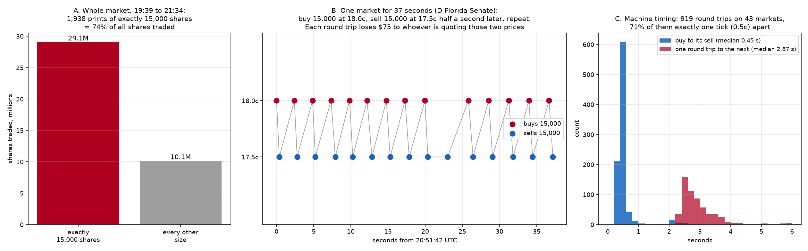

*The fingerprint. Left: from 19:39 to 21:34, orders of exactly 15,000 shares were 74% of everything traded. Middle: 37 seconds on one market, buying 15,000 at 18c and selling 15,000 at 17.5c half a second later, over and over, losing $75 each time. Right: across 919 round trips the sell came a median 0.45 seconds after the buy, which is a machine, not a person.*

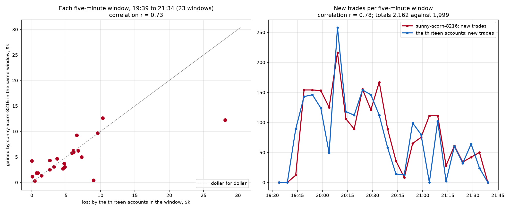

*Five-minute windows. Left: what sunny-acorn gained against what the losing accounts lost in the same window, close to dollar for dollar. Right: their new trades per window rise and fall together (correlation 0.78).*

I also tried something more direct. I put quotes in the middle of the spread, on both sides of every market it was using. A normal trader shouldn't care who is on the other side; they would just take the better price. The first time, the pairs stopped for about six minutes and then moved over to markets I hadn't covered. The second time I covered all of them, the pairs stopped again and started back up two seconds after I cancelled my quotes. Most of the time it left a market about half a second after my quote showed up. That pretty much settled it for me.

<picture>
  <source media="(prefers-color-scheme: dark)" srcset="figures/sunny-dark.png">
  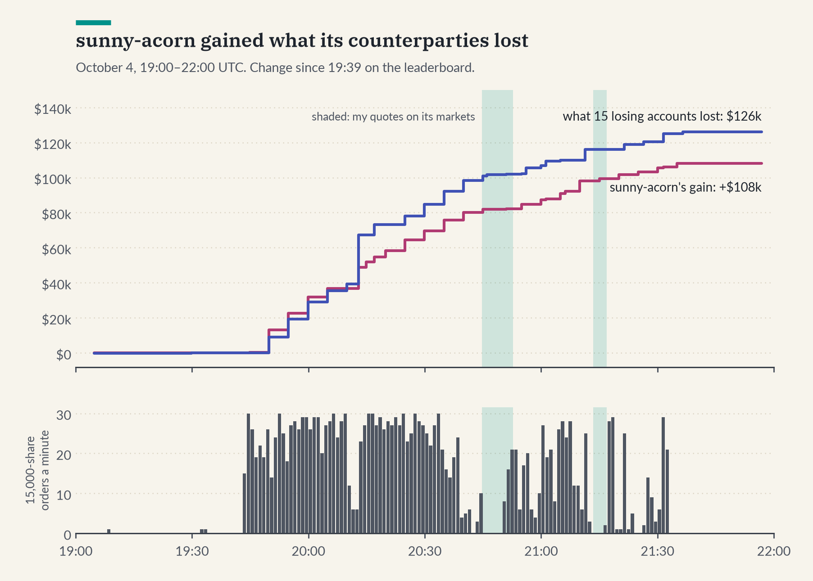
</picture>

I emailed SIG the evidence (I wasn't the only one; a lot of people reported it). On October 6 sunny-acorn and 32 other accounts were removed from the leaderboard, and 36 more the next night.

## Reading the leaderboard

Digging through sunny-acorn showed me how much information is actually in the leaderboard, and this ended up being my secret weapon. It shows every account's profit, trade count and trade volume. SIG values open positions at about the average trade price over the last five hours. I found this by matching it against my own positions: a five-hour window reproduced a $2.1k move on the board to within $250, where four- and six-hour windows didn't.

So I realized I could reconstruct a five-hour average trade price series for every market. Then, for every stretch between two leaderboard updates (which happen every 24 seconds) where an account made no trades, I compared the change in its profit with how much each market's price moved. The slope of that relationship is its position. As long as an account had enough quiet stretches, I would get a very confident estimate of what it held. If an account was an active trader it became much harder, but typically I could still pick out large holdings with reasonable confidence. On accounts that traded a lot, I could attribute fills by watching their volume. Every trade adds to both sides' volume, by shares × price for the YES buyer and shares × (1 − price) for the other side, so matching volume changes to trades on the tape, to the cent, showed who took what and on which side. That let me approximately determine other parties' quoting rules and who was taking and filling which orders.

I tested all of it on my own account first, where I knew the real answer. The first version found my biggest holding at the time, 118,733 NO on Democrats in VA-05, as somewhere between 102k and 123k. By the end, matching volume against the tape explained the leaders' volume changes exactly in 99-100% of intervals.

Some of the things it turned up:
- On October 15, the leaders mostly held near-certain races, and above all both sides of the Rhode Island Senate race. bright-finch held about 629,000 NO on Republicans there, and nimble-beacon about 222,000 YES on Democrats plus 193,000 NO on Republicans.
- calm-badger-5206, 5th on the board at the time, was the exception. Essentially all of its money was on Republicans winning the Senate.

<picture>
  <source media="(prefers-color-scheme: dark)" srcset="figures/leaders-dark.png">
  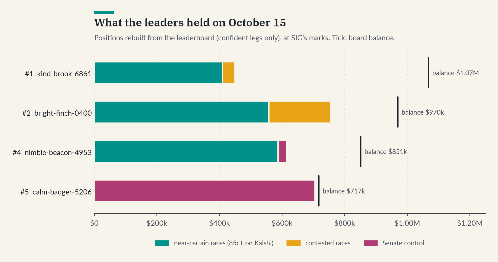
</picture>

The fit on calm-badger is about as clean as it gets. By October 15, when I found it, I had 584 quiet stretches since October 11 where only the Senate-control prices moved, and its profit matched its position to a median of $1.15. It held 1.08 million NO on Democrats and 0.52 million YES on Republicans, about 1.6 million shares, and it hadn't made a real trade since October 11, so it was just sitting on it.

How to read the chart below: each dot is a few minutes where calm-badger made no trades and only one of the two Senate-control prices changed on the leaderboard. Left to right is how much that price moved, and up and down is how much calm-badger's profit moved over the same minutes. If it held nothing, every dot would sit on the zero line. Instead the dots fall on two straight lines, and the slope of each line is the number of shares. When the Democrats' price went up 1c, calm-badger lost $10,771, so it held 1,077,121 shares that lose when Democrats gain (NO on Democrats). When the Republicans' price went up 1c, it gained $5,228, so it held 522,786 YES on Republicans. The same trick works on any account that sits still long enough.

<picture>
  <source media="(prefers-color-scheme: dark)" srcset="figures/calm_badger-dark.png">
  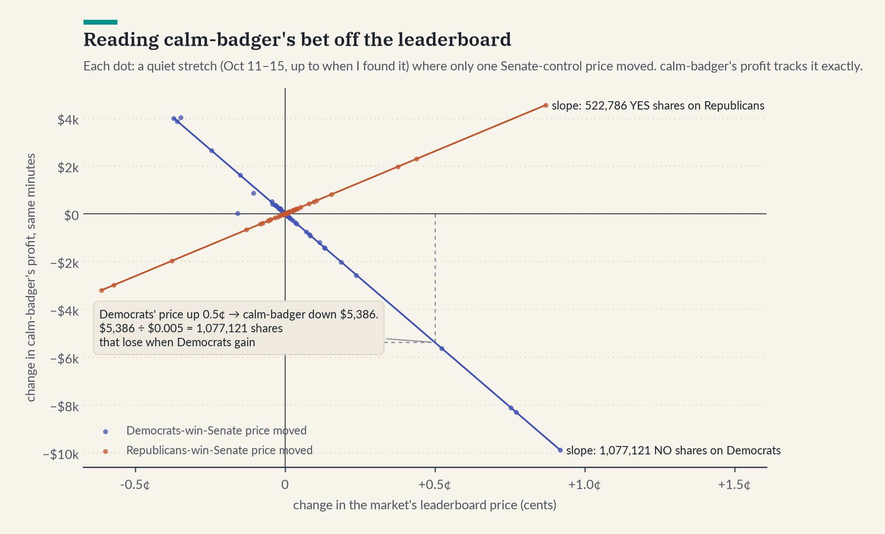
</picture>

## Betting against calm-badger

Most of the top accounts had the majority of their capital in near-certain positions, but calm-badger had all of its capital on the Republicans winning the Senate. If they won, it would have finished with about $1.6 million, almost certainly in first.

Only first, second and third paid, so at this point I didn't really care about the expected profit in fake money; I cared about my expected winnings from placement in the competition (correlated, but not the same). So I had Claude build a simulation that played out the finish 40,000 times, using every leader's estimated positions, Kalshi's odds on every race, and the election model I had built to simulate national outcomes and how they should affect state-level outcomes.

The answer was pretty obvious once I saw it. If Republicans won the Senate, calm-badger would come first no matter what I did, so the only worlds I could win in were the ones where Democrats held it. My optimal response was to simply take the opposite side with all of my account value. By October 17, doing nothing gave me almost no chance of first (0.3%). Putting everything I had, about $893k, on Democrats holding the Senate gave me about 50%, and it beat the same money on any single race like Texas or Michigan, because those can go Democratic while the Senate still goes Republican. In an earlier run, copying calm-badger was the worst thing I tested, at 4%.

<picture>
  <source media="(prefers-color-scheme: dark)" srcset="figures/endgame-dark.png">
  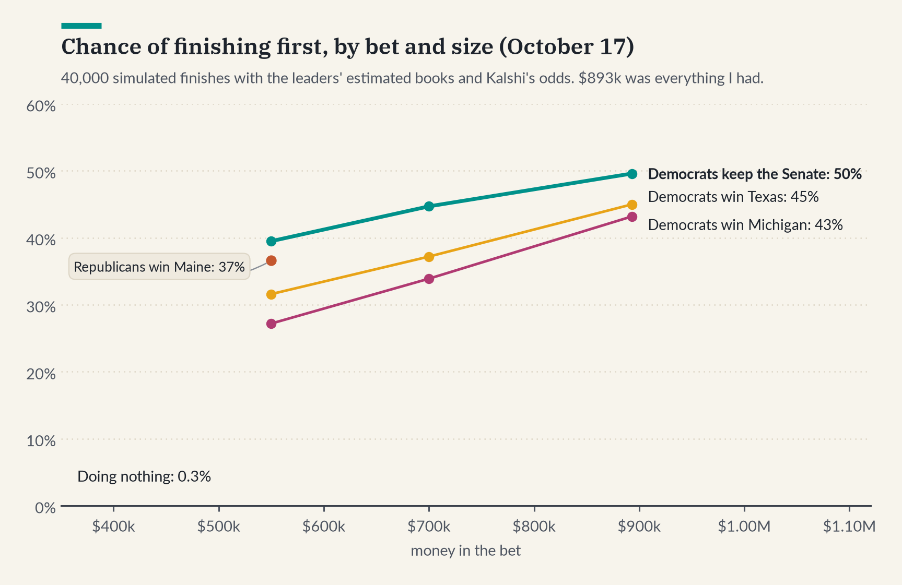
</picture>

So that's what I did. On October 18 the simulations put a $600k bet against the Republicans winning the Senate at expected winnings from competition placement of about $14k, with a 44% chance of placing first and 15% of second. (I didn't give third place any value, because I like to win, so I was biased toward winning outright or not at all. There's a saying in my family: second place is the first loser :)) To fund it I turned off most of my market making and closed about 150 positions. On October 26 I bought by hand: 404,477 YES on Democrats at 65.8c on average and 528,409 NO on Republicans at 65.1c, about $610k in one go. By November 1 I had 555,514 YES and 866,100 NO and only about $12k in cash, and the simulations had me at a 52% chance of first. If Democrats held the Senate I'd have about $1.43M, and if they didn't I'd be left with nothing.

## Election night

Democrats held the Senate, and by the early morning Kalshi had it at 99.6c. SIG's leaderboard froze from 00:04 to 03:26 UTC, the longest freeze I saw the whole competition, so for a few hours nobody could really see where they stood.

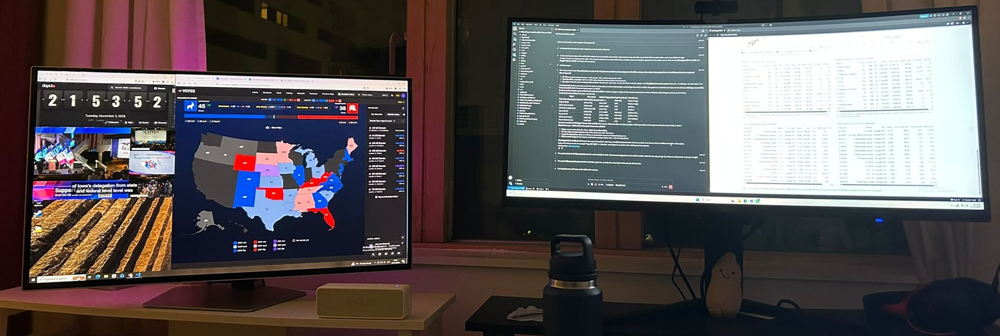

*My setup on election night: live results, AP news feed, and the countdown on the left, Claude Code and the dashboard on the right (stuffed peanut under the monitor, his name is "Peanut").*

Going into election night I noticed the liquidity was really thin, and I figured with people running latency arb there were bound to be some fat fingers, so I put stink bids (orders far from the price, waiting for a mistake) up again. Sure enough, the penny sweeps from opening day were back, with new accounts dumping likely winners for a few cents. I wanted cash to catch those, so between 01:08 and 01:28 UTC I sold 83,371 of my Senate YES at 95c, which raised $79k. I then put bids on the favorite in every market: 3.5c overnight, then 8c and 10 to 12c the next day. The bids at 3.5c and below only filled 17 times, but that was 185,158 shares for $5,831, which should be worth about $158k at settlement. The 10c bids the next afternoon added about another $63k.

## steady-ember and Mississippi

On the morning of November 4 I noticed steady-ember-8793 creeping up the board. Using the exact volume-matching method, I found it had made one bet on October 19 and hadn't traded since: 925,806 YES on Democrats in the Mississippi Senate race and 670,430 NO on Republicans, mostly bought around 20c, with only $300 left in cash. If Colom won it would finish at $1,596,536, about $1,500 ahead of me.

So I simulated what to do about it. The best answer was to move some money out of the Senate bet and into Mississippi, on the same side as steady-ember. If Colom won, every dollar there widened my lead, and if Hyde-Smith won, steady-ember would drop to almost nothing anyway, so I didn't need to worry about it. Between 10:08 and 11:13 UTC I sold another 45,240 Senate YES for $43k and put $70k into Mississippi: 37,558 YES on Democrats and 50,368 NO on Republicans. That turned a $1,500 deficit into a $16,500 lead if Colom won, and by the close, with the last few fills, it was $77k.

<picture>
  <source media="(prefers-color-scheme: dark)" srcset="figures/mississippi-dark.png">
  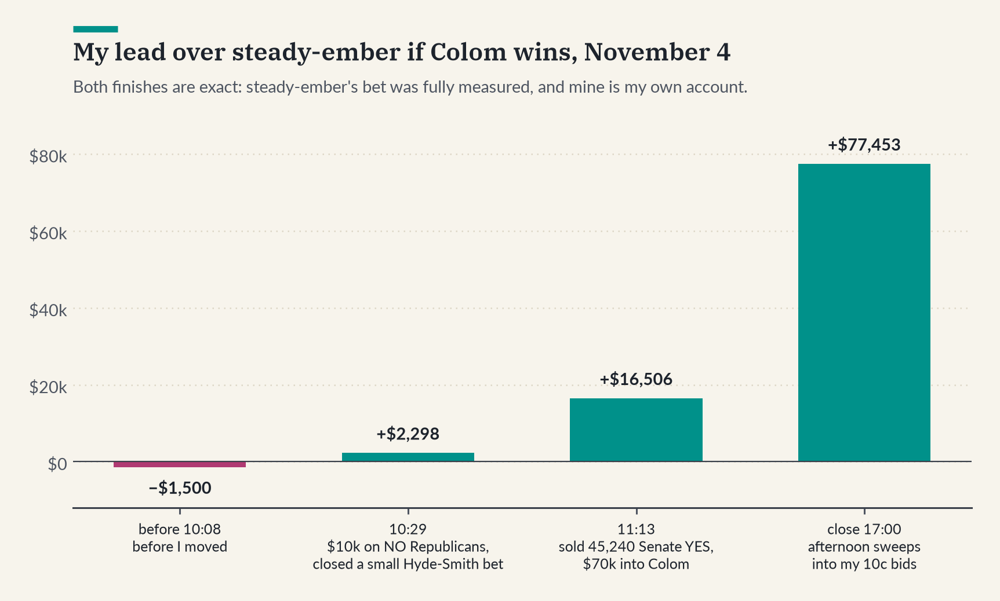
</picture>

The other big competitor was nimble-beacon (Teun), and I watched him closely the whole way. Because he traded so much (about 15,700 trades by the end, against 2,739 for steady-ember), it was really hard to get a bead on what he held. Every new trade muddies the regression, and my estimates of his finish moved by $20-30k from one day to the next. I could still pick out his big legs, like about 268,000 YES on Democrats winning the House and about 100,000 YES on the Republican in MN-01, but never with the same confidence as calm-badger or steady-ember. On election night alone he made about $119k from trading in a few hours, a lot of it from the same kind of sweeps I was catching.

## Where it stands

<picture>
  <source media="(prefers-color-scheme: dark)" srcset="figures/standings-dark.png">
  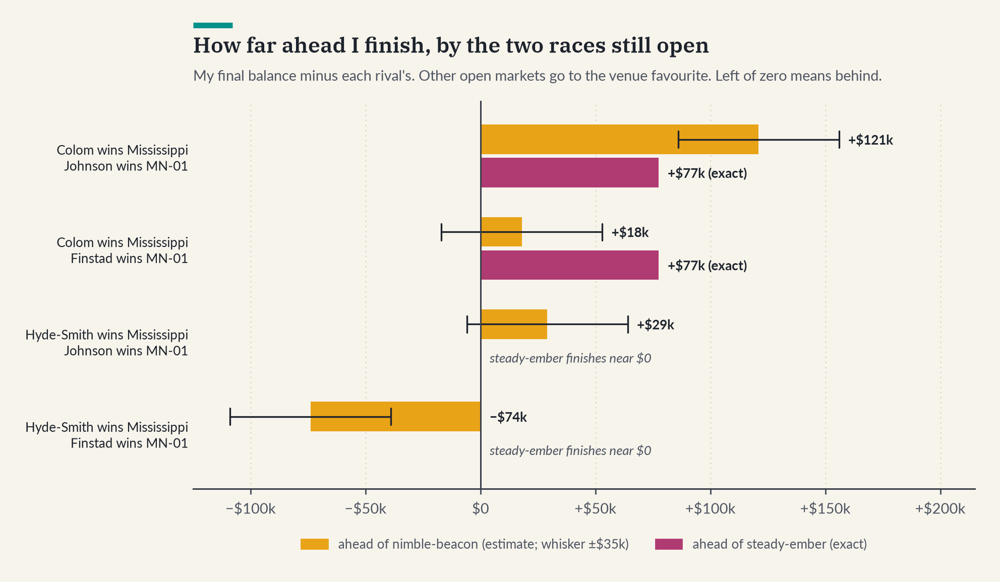
</picture>

Trading closed at noon Eastern on November 4, and settlement has been slow. 12 races (24 markets) are still open, and two of them decide the order:
- Mississippi Senate: Colom (D) leads by 2,574 votes with about 97% counted. If he holds, I finish with $1,673,989. If Hyde-Smith wins, I finish with $1,586,063.
- MN-01: Johnson (D) leads by 323 votes, and Finstad has said he'll request a recount once the state certifies the results on November 19. Nimble-beacon holds about 100,000 YES on the Republican.

My number is exact, and so is steady-ember's, but nimble-beacon's is an estimate that moved by $20-30k between my checks, so I take it with a grain of salt. Teun estimates nimble-beacon at about $1.55M, which is close to mine. If Colom and Johnson both win, I finish first by about $120k. If one of them loses it gets close, and if both lose, nimble-beacon wins.

## Claude

I believe effectively using the latest agentic tools is essential to being competitive in a competition like this. But you can't let it stop you from learning, and you have to drive the development and ideation yourself; otherwise an AI is just doing it all for you. Claude is an excellent research assistant and fact checker, and he is extremely fast at writing great code when used right. He doesn't understand some of the intuition or softer skills that go into data analysis. I used Claude to write most of the code and to monitor the system while I slept, or while I was doing other work or out of the house.
